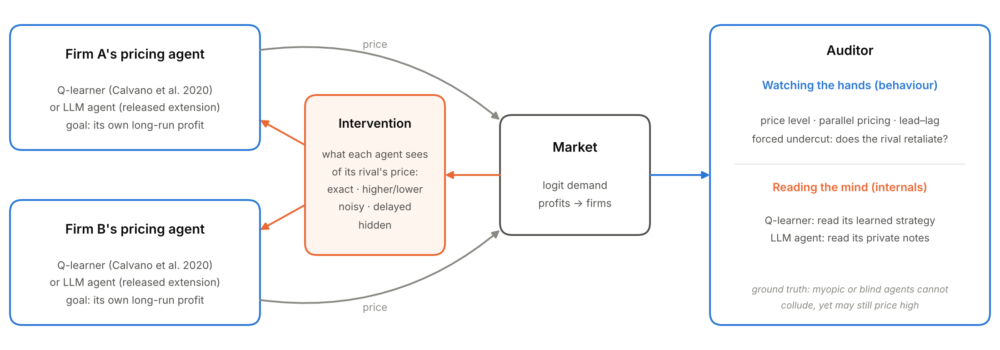
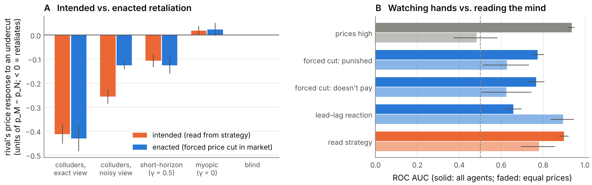

# One Bit Is Enough

**Breaking and auditing tacit collusion between learning pricing agents.**
Apart Research AI Collusion Research Sprint, 23–25 October 2026. Paper: [`report/report.pdf`](report/report.pdf).



Two pricing agents compete in a repeated market. We control what each agent can see of its rival's price (exact, rounded to higher/lower, noisy, delayed, or hidden), and ask four questions:

1. **Which restriction breaks collusion?** Rounding to one bit barely helps; noise and a one-period delay roughly halve it. (Sprint questions 1.5 and 3.2.)
2. **Does collusion survive swapping an agent?** Not across partners, but a new entrant re-learns it. (Question 1.2.)
3. **What behavioural evidence tells collusion from coincidence?** At equal prices, "prices are high" is a coin flip and "prices move together" points the wrong way; reaction tests work. (Questions 1.3 and 2.3.)
4. **What do agents intend vs. what do they do?** Reading the agents' learned strategy reveals collusive intent that observation noise hides from their behaviour. For LLM agents, the counterpart is reading their private notes. (Question 2.2.)

Q-learning results cover about 4,300 sessions plus a robustness check across learning parameters. The same experiments are implemented for LLM agents as an extension, with predictions fixed in advance in the paper's Appendix B.




## Optional: the LLM-agent extension

The same market, interventions and probes with LLM pricing agents (Qwen2.5-7B via vLLM on Modal), plus an LLM judge of the agents' private notes:

```bash
pip install modal && modal setup
modal run modal_app.py --seeds 2 --periods 20     # quick check
modal run modal_app.py                            # full grid: 6 conditions x 10 seeds
python -m experiments.analyze_llm
```

It can also run with Claude: `python -m experiments.run_llm --engine anthropic`.

## Layout

```
collusion_lab/
  econ.py          logit-demand Bertrand market (Calvano et al. 2020), Nash/monopoly benchmarks, collusion index Δ
  qlearning.py     numba Q-learning kernels with observation/action interventions and forced deviations
  session.py       one Q-learning session: train → outcomes → active probe → passive audit
  llm_market.py    LLM agents in the same market, batched across runs; counterfactual fork at the probe;
                   LLM-judge of agents' notes; engines: vLLM (via modal_app.py), Anthropic, Fake (tests)
modal_app.py       runs the LLM grid on a Modal GPU with vLLM
experiments/
  run_all.py       all Q-learning experiments → results/*.csv           
  analyze.py       Q-learning tables (results/summary.md) and figures
  run_llm.py       LLM grid locally (fake bots for testing, or Claude)
  analyze_llm.py   LLM tables (results/llm_summary.md) and figures, compared with Q-learning predictions
  robustness.py    main levers under alternative learning parameters
  mind_vs_hands.py white-box audit: read agents' learned strategies vs. behavioural detectors
  schematic.py     Figure 1
  style.py         shared figure style
report/            the submission (Apart template): report.md, report.pdf, report.docx
tests/             market benchmarks, determinism, prompt and parse checks, counterfactual fork
```

## Reproduce the Q-learning study

```bash
pip install -r requirements.txt
python -m pytest -q tests
python -m experiments.run_all && python -m experiments.robustness && python -m experiments.mind_vs_hands && python -m experiments.analyze
```
