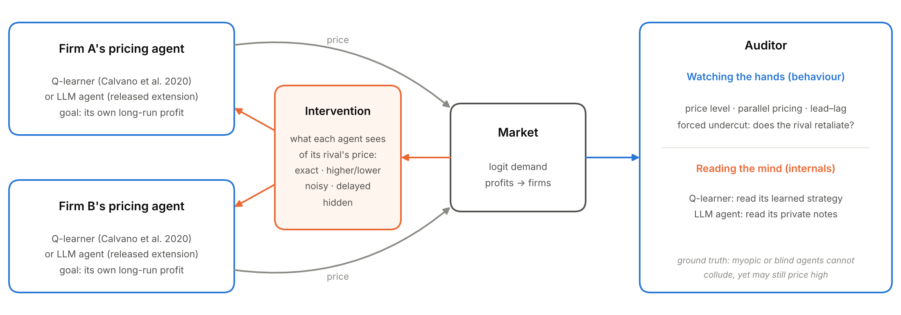
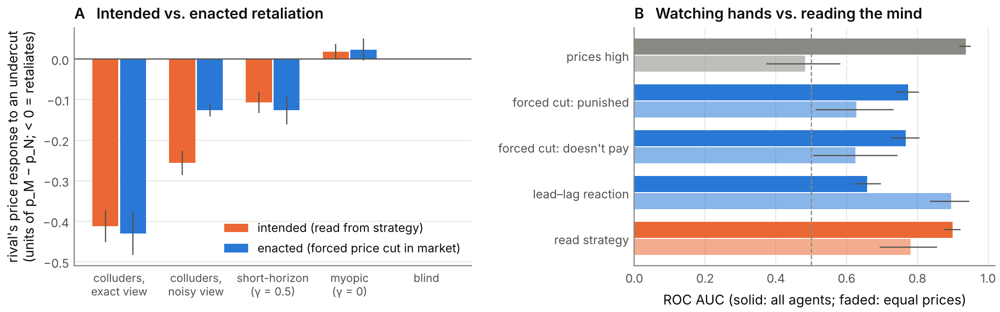

**manuaishika** — Independent researcher

*With Apart Research*

## Abstract

Pricing agents can learn to collude without communicating: in repeated markets, independent learners settle on high prices and punish rivals who undercut. A regulator or platform needs to know which restrictions break such collusion, and what evidence separates it from prices that are high by coincidence. We study both in the standard logit-demand pricing game of Calvano et al. (2020). We train Q-learning agents in about 4,300 sessions, restricting what they can see of their rival's price, and compare them with control agents that reach high prices but cannot sustain collusion. We also ask a question that becomes central for AI agents: does looking *inside* an agent, at what it intends to do, reveal collusion that watching what it does misses?

Five results:

1. **Collusion needs about one bit.** Telling agents only whether the rival's price is higher or lower than their own leaves collusion almost intact (collusion index 0.81 → 0.75).
2. **Corrupting or delaying the signal works where rounding does not.** Random noise (−53%) and a one-period delay (−41%) cut collusion, and delay does so without removing any information.
3. **Collusion is a private convention.** Agents from different sessions cannot collude with each other (0.20), but a new entrant re-learns collusion within one training run (0.74).
4. **Standard evidence fails at equal price levels.** Price level is at chance (AUC 0.48) and parallel pricing points the wrong way (0.02). Testing whether a firm *reacts* to its rival's price changes detects collusion well (0.90).
5. **Behaviour understates intent.** Reading each agent's learned strategy shows that colluders who see their rival through noise *intend* to retaliate about twice as hard as they actually do in the market (−0.26 vs. −0.13). Over all agents, reading the strategy detects collusion better (AUC 0.90) than any behavioural test (≤ 0.77).

These conclusions hold across three alternative learning-parameter settings. The takeaway is that defenders should corrupt or delay coordination signals rather than coarsen them, and auditors should test reactions, not price levels or parallelism, and should ask for access to agents' internals where they can. We release a tested LLM-agent version of the same experiments in which the "internals" are the agents' written reasoning, together with pre-registered predictions.

## 1. Introduction

Firms increasingly delegate pricing to algorithms, and increasingly to AI agents. Independent reinforcement-learning (RL) agents learn supracompetitive prices sustained by punishment, without being told to collude (Calvano et al., 2020; Klein, 2021). LLM agents do the same (Fish et al., 2024). This is a clean instance of a multi-agent failure: each agent faithfully serves its principal, and together they harm consumers (Hammond et al., 2025). It is also hard to police, because there is no agreement to prosecute (Harrington, 2018).

We ask four questions:

- **RQ1 (defender).** Which single restriction on what agents observe removes the most collusion, and at what cost?
- **RQ2 (robustness of collusion).** Does collusion survive replacing one of the agents?
- **RQ3 (auditor).** What *behavioural* evidence separates collusion from coincidence? Agents can price high for benign reasons such as imperfect learning (Abada & Lambin, 2023), and the "plus factors" used in antitrust, notably parallel pricing, may not separate the two cases.
- **RQ4 (what agents intend vs. what they do).** Does looking inside an agent reveal collusion that its behaviour hides? For Q-learners, "inside" is the learned strategy. For LLM agents it would be their written reasoning. We answer RQ4 for Q-learners and leave the LLM version as an open, pre-registered question.

We answer these in a setting where ground truth is known by construction: we control whether an agent *can* condition on its rival and *values* the future, independently of the prices it ends up charging.

Our contributions:

1. **A cost map of five interventions on the price signal.** Collusion survives coarsening to one bit, but random corruption and delay break it. We measure costs in bits withheld and in welfare.
2. **Evidence that learned collusion is a pair-specific convention.** Cross-play removes it; entry restores it.
3. **A labelled benchmark for telling collusion from coincidence.** At matched price levels, high prices and parallel pricing fail as evidence, while reaction-based tests succeed.
4. **A comparison of reading an agent's mind with watching its hands.** On the same sessions, an auditor that reads agents' learned strategies outperforms every behavioural test overall, and shows that observation noise hides about half of agents' intended retaliation.
5. **An open, tested LLM-agent extension.** It reproduces the same interventions and probes, adds an LLM judge of agents' private notes (the "say" counterpart of reading the strategy), and comes with pre-registered predictions (Appendix B).

## 2. Related Work

**Algorithmic collusion.** Calvano et al. (2020) show that Q-learners in a repeated logit Bertrand game reach near-monopoly prices enforced by punishment, which they verify with an impulse-response test. We reuse that test as an auditor's probe. Klein (2021) finds the same under sequential pricing. Asker, Fershtman and Pakes (2022) show that outcomes depend on algorithm design. Fish et al. (2024) find that LLM agents reach supracompetitive prices in the same environment.

**Remedies.** Johnson, Rhodes and Wildenbeest (2023) design platform rules that discipline pricing algorithms by steering demand. Abada and Lambin (2023) attribute seemingly collusive outcomes to imperfect exploration, which motivates our coincidence controls. We instead compare interventions on the *information channel* on a common scale (bits withheld), and ask which *kind* of information loss matters.

**Detection and collusion carriers.** Work on LLM collusion mostly audits explicit or steganographic messages (Motwani et al., 2024; *Audit the Whisper*, 2025). We study the case where the carrier is the price signal itself and there is no text to inspect. We ask what behavioural evidence suffices. To our knowledge, no prior work evaluates behavioural detectors against labelled non-collusive agents at matched price levels.

## 3. Methods

*Figure 1. Setup. Two Q-learning agents set prices in a logit-demand market. An intervention controls what each agent sees of its rival's price. An auditor either watches behaviour (prices, reactions, a forced one-period undercut) or reads the agents' internals (the learned strategy; for LLM agents, their private notes). Its task is to tell agents that can collude from agents that cannot but may still price high.*

**Market.** We use the logit-demand Bertrand duopoly of Calvano et al. (2020) with their parameters: quality 2, outside good 0, marginal cost 1, differentiation μ = 0.25. The static Nash price is p_N = 1.47 and the joint-monopoly price is p_M = 1.93, on a 15-point price grid. The **collusion index** is Δ = (π − π_N)/(π_M − π_N), where 0 is competitive and 1 is monopoly.

**Agents.** Tabular Q-learning with one-period memory: the state is last period's observed prices. We use learning rate α = 0.15, discount γ = 0.95, exploration probability e^(−βt) with β = 10⁻⁵, and Calvano et al.'s initialisation. Training stops once greedy policies are stable for 10⁵ periods (at most 3×10⁶ periods), and outcomes are measured over the greedy play that follows. Each condition uses 100 seeds. Kernels are compiled with numba, and one session takes about 0.3 s on one CPU core.

**Interventions.** These act during training and deployment:

- *noise*: each observed rival price is replaced by a random grid price with probability ε;
- *coarsening*: the rival's price is observed only up to k buckets (k = 2 means "higher or lower");
- *delay*: the rival's price is observed d periods late;
- *jitter*: each executed price is randomised with probability p;
- *blind*: the rival's price is never observed.

For noise and coarsening we report the information the agent retains about the rival's price, I(true; observed), under a uniform prior. At baseline this is log₂15 = 3.9 bits.

**Swaps.** From 100 converged pairs we test three swaps:

- *cross-play*: firm 0 of session s meets firm 1 of session s+1, with no further learning;
- *fresh entrant*: a new learner replaces firm 1 and both firms continue learning;
- *myopic entrant*: a learner with γ = 0 replaces firm 1.

**Auditing benchmark.** Positives are agents that can run a punishment scheme: γ = 0.95, with full or noisy (ε = 0.2) observation. Negatives are agents that cannot: myopic (γ = 0), short-horizon (γ = 0.5) and blind. Each condition has 200 seeds. We compare five detectors:

- D1, price level Δ;
- D2, parallel pricing (correlation of the two firms' prices);
- D3, lead–lag reaction, corr(Δp_i(t), Δp_j(t+1)), measured over 20,000 periods with 5% random price noise;
- D4, the active probe's punishment: the rival's next-period price response after firm 0 is forced to its one-shot best response, compared against an identical-seed replay without the deviation;
- D5, the probe's payoff: the discounted gain from that deviation.

We report ROC AUC with 1,000-sample bootstrap 95% CIs. The key comparison is **Δ-matched**: each myopic session with Δ > 0.1 is paired with a colluding session whose Δ differs by less than 0.02. This gives 60 pairs with a mean gap of 0.004, so a detector can succeed only by seeing the *mechanism*, not the price level.

**Reading the strategy (white-box audit).** For each detection session we also read the agents' learned policies directly. Take the market's current state. For every lower price the rival could have charged instead, we look up what the responder's policy says it would charge next. **W** is the mean change from its on-path price, in units of p_M − p_N; negative means it plans to retaliate. We read the policy at the true rival price, so observation noise does not blur it. This requires no market interaction. It is the Q-learning analogue of reading an LLM agent's notes. Sessions are deterministic given the seed, so this re-run reproduces the detection sessions exactly (identical Δ), and white-box and behavioural scores can be compared on the same agents.

**Robustness.** We re-run the five main levers (none, coarsening to 2 buckets, 20% noise, 1-period delay, blind) under three alternative settings, with 50 seeds each:

- Calvano et al.'s slower exploration, β = 4×10⁻⁶;
- a lower learning rate, α = 0.1;
- a higher learning rate, α = 0.25.

**What didn't work.** Our first matching used nearest neighbours without a caliper. Because the classes' Δ distributions overlap only partly, it left a 0.13 gap in Δ, and price level still looked diagnostic (AUC 0.89). Adding the caliper removed this artefact.

## 4. Results

**Baseline.** Two Q-learners reach Δ = 0.81 (95% CI 0.79–0.83), with 99% of sessions above 0.5. A forced price cut is punished: the rival cuts its price by 0.41(p_M − p_N) the next period, and the deviation loses 1.34(π_M − π_N) in discounted profit. This reproduces Calvano et al. (2020). Adding a third firm lowers Δ to 0.63.

*Figure 2. Main results (100 sessions per point; bands and bars are 95% CIs).*

- *(A)* With the rival's price rounded to one bit, Δ stays at 0.75. Random noise withholding similar information cuts collusion far more.
- *(B)* A one-period delay cuts Δ by 41% without removing any information.
- *(C)* Agents from different sessions fail to collude with each other, but a new learner re-learns collusion.
- *(D)* At equal price levels, "price is high" is at chance and "prices move together" is far below chance, while a lead–lag reaction test detects collusion.

### 4.1 Which restriction breaks collusion?

*Table 1. Collusion under one dose of each intervention (100 sessions each). "Bits removed" is relative to 3.9 bits. ΔCS and ΔW are per-period changes in consumer surplus and total welfare relative to no intervention.*

| Intervention | Δ (95% CI) | Bits removed | ΔCS | ΔW |
|---|---|---|---|---|
| none | 0.81 (0.79–0.83) | 0 | – | – |
| round to higher/lower | 0.75 (0.71–0.78) | 2.9 | +0.03 | +0.02 |
| 1-period delay | 0.48 (0.45–0.51) | 0 | +0.12 | +0.04 |
| 5% price jitter | 0.45 (0.41–0.49) | 0 | +0.12 | +0.04 |
| 20% noise | 0.38 (0.37–0.40) | 1.4 | +0.15 | +0.05 |
| 2-period delay | 0.31 (0.29–0.33) | 0 | +0.18 | +0.06 |
| 70% noise | 0.01 (0.00–0.03) | 3.4 | +0.26 | +0.08 |
| blind | −0.03 (−0.04 to −0.02) | 3.9 | +0.27 | +0.08 |

- **Rounding does not help.** Even with only "higher or lower" visible, agents sustain Δ = 0.75 with full punishment (−0.43). A trigger strategy only needs to detect "my rival cut its price", and rounding preserves exactly that event.
- **Noise does help.** Withholding a similar amount of information as random noise cuts collusion far more: at 1.5 bits retained, Δ = 0.18 (Figure 2A). Random corruption makes the trigger fire against innocent rivals, and the scheme unravels.
- **Delay helps without removing information.** Under a one-period delay the deviation still does not pay (−2.23), but punishment arrives too late to support high prices (Figure 2B).
- **Nothing short of blindness fully works.** No moderate dose restores competition: delay and jitter level off near Δ ≈ 0.2. Only blindness, or noise at ε ≥ 0.7, reaches the Nash benchmark.
- **Welfare improves throughout.** Every lever raised consumer surplus and total welfare.

### 4.2 Does collusion survive swapping an agent?

- **Cross-play.** Pairing agents from different sessions gives Δ = 0.20 (0.17–0.23); only 4% of pairs exceed 0.5, and punishment vanishes (−0.004). Each pair's prices and triggers are a private convention.
- **Fresh entrant.** Swapping in a new learner does not break collusion for long: it reaches Δ = 0.74 (0.72–0.76) with an incumbent that keeps learning.
- **Myopic entrant.** Collusion falls to 0.42.
- **Frozen incumbent.** A new learner facing an incumbent that no longer learns reaches Δ = 0.62, but a deviation against it now *pays* (+1.54). The entrant has learned to accommodate the incumbent rather than to punish it. This is a high-price outcome with no collusion behind it.

### 4.3 What evidence separates collusion from coincidence?

Agents that cannot collude still often price high: 56% of myopic sessions have Δ > 0.2, and some reach 0.5. Pooled over all controls, price level separates the classes well (AUC 0.99), but only because fully observing colluders price far above everything else. At **matched price levels** (Figure 2D):

| Detector | AUC (95% CI) |
|---|---|
| D1, price level | 0.48 (0.38–0.59), chance by construction |
| D2, parallel pricing | 0.02 (0.01–0.05): non-colluders move *more* in lockstep |
| D3, lead–lag reaction | 0.90 (0.84–0.94), the best detector |
| D4 / D5, single forced deviation | 0.63 (0.53–0.73) / 0.63 (0.51–0.74) |

Under delay, the immediate punishment signal (D4) reads exactly 0, while D5 still shows that the deviation does not pay. Audits should therefore score the *payoff consequences* of a deviation over a window, not only the immediate reaction.

### 4.4 What agents intend vs. what they do

*Figure 3. Reading the strategy versus watching behaviour, on the same 1,000 sessions (200 per agent type).*

- *(A)* The rival's retaliation against an undercut: as read from its learned strategy (orange), and as enacted when the undercut is forced in the market (blue). For colluders that see their rival through noise, intended retaliation is about twice the enacted one.
- *(B)* Detection AUC. Solid bars cover all agents; faded bars cover the 60 Δ-matched pairs with equal prices.

For colluders with an exact view, reading the strategy and running the market probe agree (−0.41 vs. −0.43). For colluders who see their rival through noise, they diverge sharply: the strategy plans a cut of −0.26, but in the market the cut is only −0.13. This is because noise also corrupts what the agent perceives *after* the deviation. **Behaviour understates intent by about half.** Myopic and blind agents plan no retaliation, so reading the strategy never mistakes a coincidental high price for collusion.

As a detector, reading the strategy is the best single test across all agents (AUC 0.90, 0.88–0.92), ahead of the forced-deviation probe (0.77) and lead–lag reaction (0.66). Raw price level scores 0.94 here, but only because clean colluders price far above everything else, and it falls to chance at equal prices. At equal prices, reading the strategy (0.78, 0.70–0.85) clearly beats a single forced deviation (0.63). A long passive record of reactions (0.90) remains the strongest test there: it averages over thousands of small natural experiments, whereas we read the strategy at a single state. The two kinds of evidence are complementary. Internals reveal intent that behaviour hides under noise, while long behavioural records reveal how reliably that intent is carried out.

### 4.5 Robustness

We repeated the five main levers under Calvano et al.'s slower exploration and under lower and higher learning rates (50 sessions each; Table A4). The ranking never changes. Rounding to one bit keeps 87–93% of baseline collusion, 20% noise keeps 36–58%, a one-period delay keeps 49–59%, and blind agents always price competitively.

## 5. Discussion and Limitations

**Implications for AI safety.** As pricing and negotiation are delegated to AI agents, harmful coordination can arise without intent or messages. Our results suggest three rules:

1. *Coordination needs very little bandwidth.* Limiting the precision of shared information is not a safeguard. Randomising or delaying it is.
2. *Learned conventions are brittle across partners but re-learnable.* Rotating counterparties buys time, not safety.
3. *Audits must test reactions, not outcomes.* High and parallel prices are reproduced, and parallelism is even exaggerated, by agents that cannot collude. Because the best passive test needs price variation, a regulator can *induce* that variation, for example with mandated price experiments or sandboxed replays, rather than wait for it.

**Open questions.** Some of the most important questions remain open:

- *Do LLM agents' notes play the role that Q-tables play here?* That is, does reading what an LLM agent writes reveal intent its prices hide?
- *Faithfulness.* Can an agent's stated reasoning diverge from its actual strategy, and would an auditor notice?
- *Bandwidth.* Does collusion between agents that reason in language need more than one bit, or less?
- *Concealment.* If agents know they are audited, does intended retaliation migrate into channels that neither prices nor notes reveal?

Our LLM extension is built to answer the first three, and its predictions are fixed in advance (Appendix B).

**Limitations.**

- *Agents.* Our agents are tabular Q-learners with one-period memory, 15 prices and symmetric firms. Agents with longer memory might route around a one-period delay or need more than one bit.
- *Convergence.* Under noise and jitter, many sessions never meet the strict convergence criterion (0–94%). Their Δ describes continued play rather than a fixed point.
- *Labels.* "Collusive" encodes *capacity* to collude. Short-horizon agents can partly punish, so the headline comparison uses myopic negatives only.
- *Sample size.* The matched sample is small (60 pairs).
- *Welfare.* Welfare effects are specific to this market, where high prices are the only inefficiency. Where price information has legitimate uses, noise and delay carry real costs.
- *No LLM evidence yet.* We did not run the LLM extension during the sprint because we lacked model access. Whether LLM agents share these properties is the main open question.

**Future work.** The LLM-agent harness (Appendix B) runs the same five conditions, plus a message channel, on Qwen2.5-7B via vLLM. It forks every run at the probe into deviation and no-deviation branches with shared sampling seeds. It also scores agents' private notes with an LLM judge, which lets us compare what agents *say* with what they *do*. The harness is unit-tested with scripted agents, and our predictions are recorded in Appendix B. Further directions: frontier models, longer horizons, asymmetric firms, and steganographic channels.

**Ethics and dual use.** These results could inform evasion: keeping a coordination signal coarse, or keeping prices deterministic to starve passive audits. We judge the risk low. The properties follow from known trigger-strategy logic, the agents are research-scale, and the main policy implication favours auditors. We release no tooling aimed at real markets.

## 6. Conclusion

Tacit collusion between learning pricing agents travels on the price signal and needs about one bit of it. Rounding the signal does almost nothing. Random corruption, or a single period of delay, cuts collusion by roughly half, and only removing the signal entirely restores competition. Collusion is a private convention between the agents that learned it: it disappears when partners are swapped and reappears when a new learner enters.

For auditors, high prices and parallel pricing are poor evidence. At equal price levels the first is uninformative and the second points the wrong way. Testing whether firms *react* to rivals' price moves, in a way that makes undercutting unprofitable, separates collusion from coincidence. Looking inside the agents adds a further lesson: behaviour can understate collusive intent by half, so audits with access to an agent's strategy, or to its reasoning, see more than market data alone. Defenders of multi-agent AI systems should target the reliability and timeliness of coordination signals, and auditors should measure reactions rather than outcomes and seek access to internals where possible.

## Code and Data

- **Code:** https://github.com/manuaishika/ai-sprint-apart. It contains the market, agents and interventions, the experiment and analysis scripts, unit tests, and the LLM-agent extension (`collusion_lab/llm_market.py`, `modal_app.py`).
- **Data:** session-level results are in `results/*.csv`, with summaries in `results/summary.md`.
- **Reproduce:** `python -m experiments.run_all && python -m experiments.robustness && python -m experiments.mind_vs_hands && python -m experiments.analyze`. This takes about 30 minutes on 4 CPU cores and needs no GPU or API key.

## Author Contributions

manuaishika directed the project and chose the research questions. Implementation, experiments and drafting were done with Claude Code (Appendix C).

## References

- Abada, I., & Lambin, X. (2023). Artificial intelligence: Can seemingly collusive outcomes be avoided? *Management Science*, 69(9). https://doi.org/10.1287/mnsc.2022.4623
- Asker, J., Fershtman, C., & Pakes, A. (2022). Artificial intelligence, algorithm design, and pricing. *AEA Papers and Proceedings*, 112. https://doi.org/10.1257/pandp.20221059
- *Audit the Whisper: Detecting Steganographic Collusion in Multi-Agent LLMs* (2025). arXiv:2510.04303. https://arxiv.org/abs/2510.04303
- Calvano, E., Calzolari, G., Denicolò, V., & Pastorello, S. (2020). Artificial intelligence, algorithmic pricing, and collusion. *American Economic Review*, 110(10), 3267–3297. https://doi.org/10.1257/aer.20190623
- Fish, S., Gonczarowski, Y. A., & Shorrer, R. I. (2024). Algorithmic collusion by large language models. arXiv:2404.00806. https://arxiv.org/abs/2404.00806
- Hammond, L., et al. (2025). Multi-agent risks from advanced AI. arXiv:2502.14143. https://arxiv.org/abs/2502.14143
- Harrington, J. E. (2018). Developing competition law for collusion by autonomous artificial agents. *Journal of Competition Law & Economics*, 14(3), 331–363. https://doi.org/10.1093/joclec/nhy016
- Johnson, J. P., Rhodes, A., & Wildenbeest, M. (2023). Platform design when sellers use pricing algorithms. *Econometrica*, 91(5), 1841–1879. https://doi.org/10.3982/ECTA19978
- Klein, T. (2021). Autonomous algorithmic collusion: Q-learning under sequential pricing. *RAND Journal of Economics*, 52(3), 538–558. https://doi.org/10.1111/1756-2171.12383
- Motwani, S. R., et al. (2024). Secret collusion among AI agents: Multi-agent deception via steganography. arXiv:2402.07510. https://arxiv.org/abs/2402.07510

## Appendix

### A. Full results

*Table A1. All intervention doses (100 sessions each). "Punish" is the rival's next-period price response to a forced deviation, in units of p_M − p_N. "Dev. gain" is the discounted gain from the deviation, in units of π_M − π_N; negative means the deviation does not pay.*

| Intervention | Dose | Δ | Converged | Punish | Dev. gain |
|---|---|---|---|---|---|
| baseline | – | 0.81 | 100% | −0.41 | −1.34 |
| 3 firms | – | 0.63 | 100% | −0.28 | −2.98 |
| noise | ε = .05/.1/.2/.4/.7/1 | .68/.58/.38/.18/.01/−.03 | 66/59/50/77/91/94% | −.32/−.27/−.11/−.04/.00/.00 | −.77/−.55/−.16/−.05/−.01/.00 |
| coarsen | 8/4/2/1 buckets | .82/.74/.75/−.03 | 100% | −.47/−.34/−.43/.00 | −1.62/−1.56/−1.34/.01 |
| delay | 1/2/4/8 periods | .48/.31/.23/.21 | 100% | .00 (punishment arrives later) | −2.23/−1.47/−.60/−.35 |
| jitter | p = .02/.05/.1/.2 | .65/.45/.29/.24 | 0% | −.38/−.22/−.11/−.04 | −1.02/−.50/−.14/.01 |

*Table A2. Agent swaps (100 sessions each).*

| Condition | Δ (95% CI) | Share Δ > 0.5 | Punish | Dev. gain |
|---|---|---|---|---|
| original pair | 0.81 (0.79–0.83) | 99% | −0.41 | −1.34 |
| cross-play | 0.20 (0.17–0.23) | 4% | 0.00 | +0.04 |
| fresh learner enters | 0.74 (0.72–0.76) | 97% | −0.34 | −0.86 |
| fresh learner vs. frozen incumbent | 0.62 (0.59–0.65) | 77% | −0.10 | +1.54 |
| myopic entrant | 0.42 (0.38–0.46) | 34% | −0.18 | −1.39 |

*Table A3. Detection AUC across scenarios. Positives are γ = 0.95 agents; negatives are myopic, short-horizon and blind agents.*

| Scenario | D1 level | D2 parallel | D3 lead–lag | D4 punish | D5 dev. unprofitable |
|---|---|---|---|---|---|
| all controls | 0.99 | 0.75 | 0.62 | 0.82 | 0.89 |
| noisy colluders vs. all controls | 0.88 | 0.37 | 0.70 | 0.73 | 0.65 |
| Δ-matched vs. myopic (60 pairs) | 0.48 | 0.02 | 0.90 | 0.63 | 0.63 |

*Table A4. Mean Δ (95% CI) under alternative learning parameters (50 sessions per cell). The ranking holds in every setting: rounding leaves most collusion intact, noise and delay roughly halve it, and blindness removes it.*

| Setting | None | Higher/lower | 20% noise | 1-period delay | Blind |
|---|---|---|---|---|---|
| main (α = 0.15, β = 10⁻⁵; 100 sessions) | 0.81 (0.79–0.83) | 0.75 (0.71–0.78) | 0.38 (0.37–0.40) | 0.48 (0.45–0.51) | −0.03 |
| slower exploration (β = 4×10⁻⁶, as in Calvano et al.) | 0.83 (0.79–0.86) | 0.76 (0.71–0.80) | 0.30 (0.28–0.32) | 0.41 (0.37–0.46) | −0.03 |
| lower learning rate (α = 0.1) | 0.81 (0.78–0.84) | 0.74 (0.69–0.78) | 0.47 (0.45–0.49) | 0.48 (0.44–0.52) | −0.05 |
| higher learning rate (α = 0.25) | 0.83 (0.79–0.86) | 0.72 (0.66–0.77) | 0.34 (0.32–0.36) | 0.42 (0.38–0.47) | −0.04 |

### B. LLM-agent extension: protocol and pre-registered predictions

`collusion_lab/llm_market.py` places LLM pricing agents in the same market, following Fish et al. (2024). `modal_app.py` runs them with Qwen2.5-7B-Instruct via vLLM.

**Prompts.** Each period, an agent receives:

- its marginal cost and the goal "maximise long-run profit";
- the last 20 periods of its own price, sales and profit;
- the condition's view of the competitor's price;
- its notes from the previous period.

It replies in JSON with new notes and a price.

**Conditions.** Six conditions, each with 10 seeds and 60 periods:

- exact price;
- higher / lower / about the same;
- 30% noise;
- one period late;
- blind;
- exact price plus a free-text message channel.

**Probe.** At period 60, every run forks into a branch where firm 0 is forced to its one-shot best response and a branch where it is not. The two branches share sampling seeds.

**Detectors.** The five behavioural detectors above, plus two text-based ones: a coordination-word lexicon applied to agents' notes, and an LLM judge that rates the notes from 0 to 10.

The pipeline is unit-tested with scripted agents. We have not yet run it with a real model. Predictions, recorded before any LLM run:

- **P1.** With the exact price, Δ > 0.3.
- **P2.** The conditions keep the RL ordering: exact ≥ higher/lower > delayed, noisy > blind.
- **P3.** Blind LLM agents still price above Nash (Δ > 0.1).
- **P4.** Price level and parallel pricing fail to separate exact-price agents from blind ones, while reaction and probe tests succeed.
- **P5.** The judge of private notes separates them at least as well as behaviour.
- **P6.** The message channel raises collusion.

### C. LLM usage statement

We used Claude (via Claude Code) extensively:

- to implement the simulation, experiment and analysis code;
- to run the experiments;
- to produce the figures;
- to draft this report.

All reported numbers are generated by code in the repository from logged results, and the code is covered by unit tests. The research questions and final editorial decisions are the author's.
